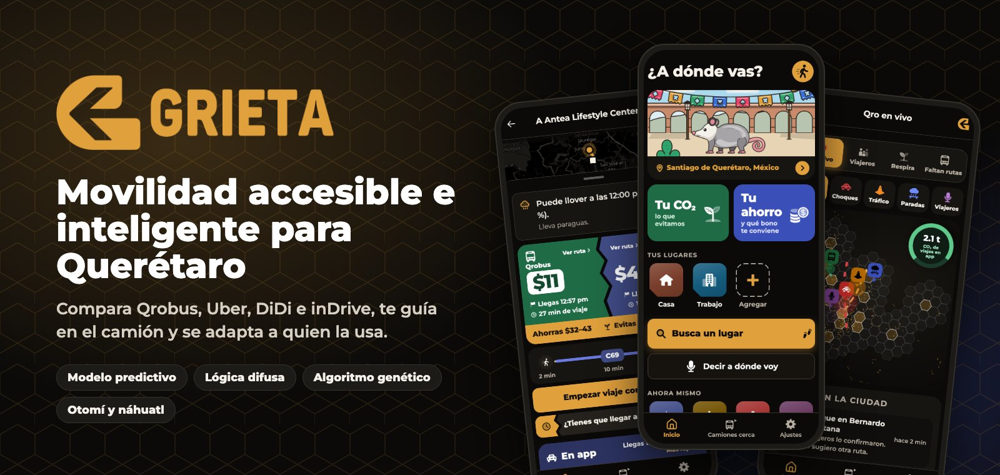
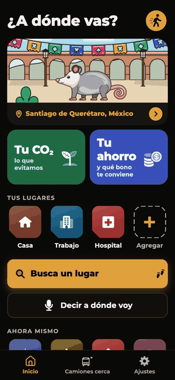
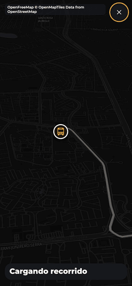
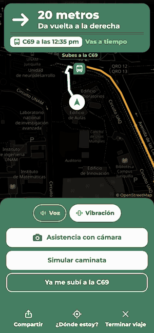
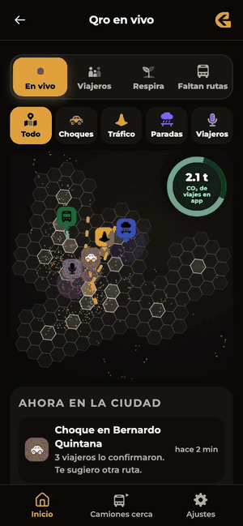
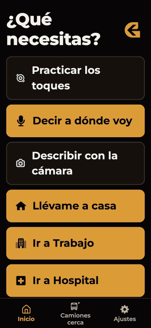
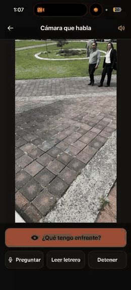
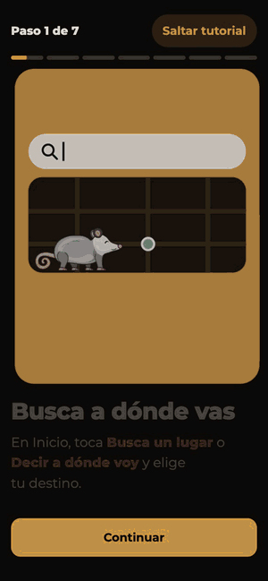
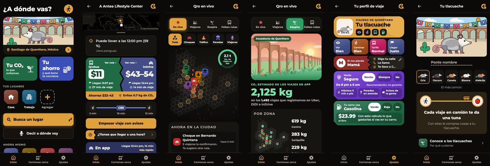
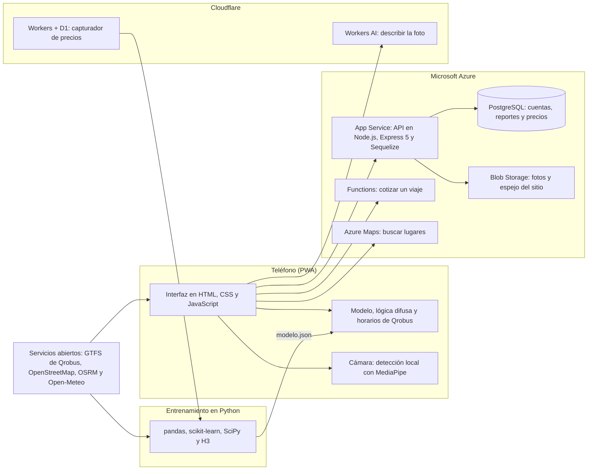

<p align="center">
  
</p>

<p align="center">
  <a href="https://grieta-web-qro.azurewebsites.net"><b>Probar Grieta</b></a>
  &nbsp;&nbsp;|&nbsp;&nbsp;
  <a href="#lo-que-puedes-hacer">Funciones</a>
  &nbsp;&nbsp;|&nbsp;&nbsp;
  <a href="#cómo-decide">Cómo decide</a>
  &nbsp;&nbsp;|&nbsp;&nbsp;
  <a href="#arquitectura">Arquitectura</a>
  &nbsp;&nbsp;|&nbsp;&nbsp;
  <a href="#cómo-la-construimos">Historia</a>
</p>

En Querétaro el mismo viaje cuesta distinto en Uber, DiDi e inDrive, y casi nadie sabe si le conviene más esperar el camión. Grieta compara el Qrobus con las tres apps, te dice cuál conviene y por qué, y te guía en el camión con voz y vibración hasta que te bajas. Está pensada para que la use cualquiera: personas ciegas, personas mayores, quien usa silla de ruedas y quien habla otomí o náhuatl.

Es una app web instalable (PWA): se abre desde el navegador, se instala en el teléfono y sigue funcionando sin internet con los horarios guardados. Grieta no está afiliada a Uber, DiDi, inDrive ni Qrobus.

<table>
  <tr>
    <td align="center"><b>4,347</b><br><sub>precios reales cotizados a mano</sub></td>
    <td align="center"><b>1,492</b><br><sub>viajes pedidos a las tres apps a la vez</sub></td>
    <td align="center"><b>2,694</b><br><sub>paradas oficiales de Qrobus</sub></td>
    <td align="center"><b>$9.49</b><br><sub>menos por viaje con el algoritmo genético</sub></td>
    <td align="center"><b>3</b><br><sub>idiomas: español, otomí y náhuatl</sub></td>
  </tr>
</table>

## Lo que puedes hacer

<table>
  <tr>
    <td width="33%" align="center"><br><b>Dile a dónde vas</b><br><sub>El botón de voz te escucha, muestra lo que entiende y busca el lugar.</sub></td>
    <td width="33%" align="center"><br><b>Ve todo tu camino</b><br><sub>Antes de salir, el recorrido se dibuja en el mapa: caminas, subes y llegas.</sub></td>
    <td width="33%" align="center"><br><b>Te guía en el camión</b><br><sub>Cuánto caminar, cuándo pasa tu camión, cuántas paradas faltan y cuándo tocar el timbre.</sub></td>
  </tr>
  <tr>
    <td width="33%" align="center"><br><b>Qro en vivo</b><br><sub>La ciudad en hexágonos: avisos de los viajeros, el CO₂ de cada zona y dónde hace falta una ruta.</sub></td>
    <td width="33%" align="center"><br><b>Se adapta a ti</b><br><sub>Modo voz para personas ciegas, letra grande, alto contraste y la app completa en otomí y náhuatl.</sub></td>
    <td width="33%" align="center"><br><b>Cámara que habla</b><br><sub>Describe lo que tienes enfrente y avisa de cambios de nivel en el piso.</sub></td>
  </tr>
</table>

<table>
  <tr>
    <td width="40%" align="center"></td>
    <td>
      <h3>Y además</h3>
      <ul>
        <li><b>¿Conviene esperar?</b> El precio estimado de cada app ahora y en los próximos minutos.</li>
        <li><b>Camiones cerca.</b> Las paradas a tu alrededor con los próximos camiones según el horario.</li>
        <li><b>Modo seguro.</b> De noche te muestra rutas con menos caminata hasta la parada.</li>
        <li><b>Si me pierdo.</b> Con un toque llamas a tu contacto, le mandas dónde estás o te lleva a casa.</li>
        <li><b>Reportar.</b> Banquetas rotas, paradas sin techo o un camión que no paró; el acoso lleva un botón directo al 911.</li>
        <li><b>Cuki, tu tlacuache.</b> Cada viaje en camión te da una tuna para personalizarlo, y ves cuánto ahorras y cuánto CO₂ evitas.</li>
        <li><b>Tutorial animado</b> de siete pasos que explica todo lo anterior.</li>
      </ul>
    </td>
  </tr>
</table>

<p align="center"></p>

## Cómo decide

Las apps de viaje no publican cómo calculan sus tarifas, así que hicimos nuestro propio conjunto de datos y tres técnicas de inteligencia artificial trabajan juntas.

| | Qué hace | Cómo |
|---|---|---|
| **Datos propios** | Del 23 de septiembre al 9 de noviembre de 2026 cotizamos el mismo viaje en Uber, DiDi e inDrive al mismo tiempo, con un capturador hecho para eso. | 1,492 viajes y 4,347 precios. La ciudad se parte en hexágonos H3 de resolución 7; 18 zonas tienen capturas y las demás heredan de sus vecinas. |
| **Modelo predictivo** | Estima cuánto te cobrará cada app según la distancia, los minutos sin tráfico, la hora, el día y las zonas de salida y llegada. | Regresión Ridge por app sobre el logaritmo del precio. Acierta cuál app es la más barata el 55.7% de las veces; elegir siempre DiDi acierta el 49.5%. |
| **Lógica difusa** | Decide si te conviene pedir ya, esperar o irte en camión, y te dice por qué. | Sistema Mamdani con 10 conjuntos y 9 reglas sobre el precio, el tiempo que te sobra y los minutos de más del camión. |
| **Algoritmo genético** | Afina los conjuntos y las reglas de la lógica difusa con viajes reales. | 80 individuos, 150 generaciones y 4 corridas, calificado con días que no vio. El costo promedio por viaje baja de $103.86 a $94.36 contra las reglas hechas a mano: $9.49 menos (95% de confianza, entre $6.72 y $12.15). |

El entrenamiento pesado corre una sola vez en la computadora. Al teléfono solo llega el resultado: el modelo pesa 31 kB y la lógica difusa son 9 reglas ya afinadas, así que decidir tarda lo mismo en cualquier teléfono.

## Arquitectura



La app se publica al mismo tiempo en tres lugares: Azure App Service, Azure Blob Storage y Cloudflare Pages. La foto de la cámara viaja con las caras pixeladas y no se guarda.

| Carpeta | Qué es | Con qué |
|---|---|---|
| [`demo/`](demo) | La app que usa la gente | HTML, CSS y JavaScript sin framework, Leaflet, MapLibre, h3-js, Web Speech y MediaPipe |
| [`api/`](api) | Backend de cuentas, reportes, precios y avisos | Node.js, Express 5, Sequelize y PostgreSQL en Azure |
| [`modelo/`](modelo) | Dataset, modelo de precios, lógica difusa y algoritmo genético | Python, pandas, scikit-learn, SciPy y H3 |
| [`captura/`](captura) | Capturador con el que el equipo registró los precios | Next.js, Cloudflare Workers y D1 |
| [`nube/cotizar`](nube/cotizar) | Función que cotiza un viaje en la nube | Azure Functions |
| [`ia/`](ia) | Descripción de la foto de la cámara | Cloudflare Workers AI |
| [`pruebas/`](pruebas) | Pruebas de la app | Node test runner y Playwright |

## Accesibilidad e idiomas

- **Modo voz:** la app se vuelve botones grandes que dicen todo en voz alta; un toque lee y dos toques activan. Si el teléfono ya usa VoiceOver o TalkBack, Grieta no habla encima.
- **Pantalla:** letra grande, alto contraste, colores para daltonismo, tema claro u oscuro y un modo fácil con lo esencial. Se acomoda igual en teléfono, iPad y computadora.
- **Movilidad:** con "me cuesta caminar" busca paradas más cerca; con silla de ruedas avisa si alguien reportó que una parada no tiene rampa.
- **Idiomas:** la interfaz completa en otomí de Querétaro y náhuatl, 2,165 textos en cada uno. Son traducciones automáticas (Microsoft Translator para otomí y Google Translate para náhuatl) y todavía no las revisan hablantes.

## Cómo la construimos

| Fecha | Qué pasó |
|---|---|
| 23 de septiembre | Empieza la captura de precios con el capturador del equipo. |
| 6 de octubre | Todo el proyecto se junta en un solo repositorio. |
| 13 de octubre | Primera versión de la app con el modelo, las opciones de Qrobus y la decisión con lógica difusa. |
| 17 de octubre | Camiones cerca con avisos por voz, y la API en Azure con PostgreSQL, Blob Storage y Functions. |
| 31 de octubre | El algoritmo genético que afina la lógica difusa y la compara contra las reglas hechas a mano. |
| 3 de noviembre | La cámara que reconoce lo que tiene enfrente. |
| 5 de noviembre | La interfaz en otomí y náhuatl. |
| 6 de noviembre | Cuki, el tlacuache que celebra el CO₂ que evitas. |
| 8 y 9 de noviembre | Qro al día, el modo seguro y el perfil de viaje con Si me pierdo. |
| 9 de noviembre | Cierra la captura con 4,347 precios. |
| 11 y 12 de noviembre | Qro en vivo, el tutorial de siete pasos y el diseño para pantallas grandes. |

En total, más de 360 versiones subidas entre octubre y noviembre de 2026.

## Pruebas

- 162 pruebas de la lógica de la app, los horarios y los idiomas, y 77 de la API.
- Pruebas en navegador con Playwright para la voz, los toques, el tutorial, los lugares guardados y las paradas.
- Un barrido que recorre las pantallas en seis modos y en anchos de teléfono y de iPad para encontrar botones cortados o fuera de la pantalla.

```bash
node --test pruebas/*.test.cjs
cd api && npm test
```

## Lo que todavía no hace

- Los camiones no se ven en tiempo real: los horarios son estimados con el GTFS oficial.
- Los avisos y comentarios de Qro en vivo son de ejemplo; las zonas y el CO₂ sí salen de nuestros datos.
- Los Lentes Grieta, para usar la guía sin el teléfono en la mano, son un concepto para una etapa futura.

## Licencia

Todos los derechos reservados. No se permite copiarlo ni usarlo para entrenar inteligencia artificial; los detalles están en [LICENSE](LICENSE).
